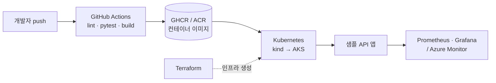

# devops-portfolio

> QA 엔지니어 5년 → DevOps / 클라우드 운영 엔지니어로 전환하며 쌓아 가는 실습 포트폴리오

Linux 서버 점검 스크립트부터 시작해 **CI/CD → Docker → Kubernetes → Azure 배포 → Terraform·모니터링**까지,
하나의 샘플 앱을 단계별로 키워 가며 "코드 한 줄이 운영 환경에 배포되기까지"의 전 과정을 직접 구성합니다.

- 📅 시작: 2026년 11월
- 📍 현재 단계: **1단계 Linux·운영체제 기초**
- 🗺️ 전체 계획과 체크리스트: [ROADMAP.md](./ROADMAP.md)
- 📝 주간 학습 기록: [docs/weekly/](./docs/weekly/)

---

## 🙋 왜 이 프로젝트인가

QA로 일하며 **Selenium 테스트 자동화**, **Jenkins CI/CD 파이프라인 운영**, **Windows 배치 스크립트**로
빌드·테스트 반복 작업을 자동화해 왔습니다. 이 과정에서 "테스트가 돌아가는 환경과 배포 파이프라인 자체"에
더 관심이 생겨 DevOps로 방향을 정했습니다.

이 저장소는 QA 경험에서 가져온 원칙을 운영 영역으로 옮기는 기록입니다.

| QA에서의 경험 | 이 포트폴리오에서 이어지는 부분 |
| --- | --- |
| Jenkins로 테스트 자동 실행 | GitHub Actions로 lint·test·build·deploy 자동화 |
| 테스트 환경 구성·재현 | Docker / docker compose로 같은 환경을 코드로 재현 |
| 결함 재현과 원인 좁히기 | 서버 점검 스크립트, 로그 분석, 모니터링 |
| 배치 스크립트로 반복 작업 제거 | bash·Python 자동화, Terraform으로 인프라 코드화 |

---

## 🏗️ 목표 아키텍처 (최종)



> 단계가 진행되면서 실제 구성에 맞게 업데이트합니다.

---

## 🧰 기술 스택

| 영역 | 사용 기술 |
| --- | --- |
| OS·셸 | Linux (Ubuntu on WSL2), bash |
| 네트워크 | curl, dig, ss, traceroute, Nginx |
| 언어 | Python (Flask/FastAPI, pytest) |
| CI/CD | GitHub Actions (+ Jenkins 경험 비교) |
| 컨테이너 | Docker, docker compose |
| 오케스트레이션 | Kubernetes (kind / minikube), Helm |
| 클라우드 | Microsoft Azure (ACR, AKS / Container Apps) |
| IaC·모니터링 | Terraform, Prometheus, Grafana, Azure Monitor |

---

## 📂 저장소 구조

```
devops-portfolio/
├── linux/          # 1단계: 서버 점검 스크립트, Linux 정리 노트
├── network/        # 2단계: 네트워크 실습 기록, 헬스체크 스크립트
├── app/            # 3단계~: 배포용 샘플 API 앱
├── scripts/        # 3단계: 로그 분석 등 Python 자동화 스크립트
├── .github/        # 4단계: GitHub Actions 워크플로, PR 템플릿
├── k8s/            # 6단계: Kubernetes 매니페스트
├── helm/           # 6단계: Helm 차트
├── azure/          # 7단계: Azure 배포 스크립트·문서
├── terraform/      # 8단계: Azure 리소스 IaC
├── monitoring/     # 8단계: 모니터링 설정
├── docs/           # CI/CD 문서, 트러블슈팅, 주간 학습 기록
├── ROADMAP.md
└── README.md
```

---

## 📈 진행 상황

| 단계 | 주제 | 주요 결과물 | 상태 |
| --- | --- | --- | --- |
| 1 | Linux·운영체제 기초 | `linux/server_check.sh`, 정리 노트 | 🟡 진행 중 |
| 2 | 네트워크 기초 | `network/` 실습 기록, 헬스체크 | ⚪ 예정 |
| 3 | Python 자동화 | `app/`, `scripts/`, pytest | ⚪ 예정 |
| 4 | Git·CI/CD | `.github/workflows/`, `docs/ci-cd.md` | ⚪ 예정 |
| 5 | Docker | `Dockerfile`, `compose.yaml`, GHCR | ⚪ 예정 |
| 6 | Kubernetes | `k8s/`, `helm/` | ⚪ 예정 |
| 7 | Azure | `azure/`, 배포 파이프라인 | ⚪ 예정 |
| 8 | IaC·모니터링 | `terraform/`, `monitoring/` | ⚪ 예정 |

세부 체크리스트는 [ROADMAP.md](./ROADMAP.md)에서 관리합니다.

---

## ▶️ 실행해 보기

### 서버 점검 스크립트 (1단계)

WSL2(Ubuntu) 또는 Linux 환경에서 실행합니다.

```bash
git clone https://github.com/ereemee/devops-portfolio.git
cd devops-portfolio
chmod +x linux/server_check.sh
./linux/server_check.sh

# 디스크 사용률 경고 기준 변경 (기본 80%)
DISK_LIMIT=70 ./linux/server_check.sh
```

출력 항목: 디스크 사용률(기준 초과 시 ⚠ 표시), 메모리 사용량, 메모리 사용 상위 프로세스

> 이후 단계의 실행 방법(앱 실행, docker compose, kind 배포 등)은 단계가 완료될 때마다 이 섹션에 추가합니다.

---

## 🔐 보안·비용 원칙

- 비밀번호·키·구독 ID 등 비밀 값은 커밋하지 않습니다 → `.gitignore`, GitHub Secrets 사용
- Azure 실습은 가장 작은 SKU를 사용하고, 실습 후 `az group delete`로 리소스를 삭제합니다

---

## 🔗 관련 저장소

- [mobile-qa-automation](https://github.com/ereemee/mobile-qa-automation): 모바일 테스트 자동화 포트폴리오
  (이후 이 저장소의 CI/CD·Docker 환경에서 테스트를 실행하도록 연결할 예정)

---

## 📄 License

[MIT](./LICENSE)
